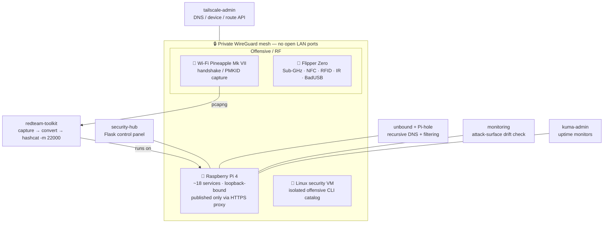

<div align="center">

# 🛰️ homelab-security-lab

**A self-hosted privacy-and-security lab on a single Raspberry Pi — offensive tooling, defensive monitoring, and a private mesh, run like production.**

[](LICENSE)


*The public, sanitized subset of a homelab I design, harden, and operate myself.*

</div>

---

<details>
<summary><b>Contents</b></summary>

- [Why this exists](#why-this-exists)
- [Architecture](#architecture)
- [What's inside](#whats-inside)
- [Engineering highlights](#engineering-highlights)
- [Tech & tooling](#tech--tooling)
- [Repository layout](#repository-layout)
- [Writeups](#writeups)
- [Authorization & ethics](#authorization--ethics)
- [About](#about)

</details>

## Why this exists

I wanted one place to practice the loop that real security work actually runs on: **stand a service
up, expose it deliberately (never by accident), monitor it, attack it inside a bounded lab, and
prove the fix on the real path — not on paper.**

It started as a single headless Raspberry Pi 4 and grew into ~18 self-hosted services plus the
offensive/defensive gear that lives alongside them — a Wi-Fi Pineapple, a Flipper Zero, a
host-level toolkit, and an isolated Linux security VM. The whole thing is managed remotely over a
WireGuard mesh and built to survive as a *"hide it in a closet and never physically touch it
again"* box.

This repo is the **sanitized public view**: the engineering, not the live configs. Every real
hostname, IP, credential, MAC, and Wi-Fi name is redacted; no captured data ships here; and the
media/download side of the lab is deliberately left out.

## Architecture



**Design rules the whole lab is held to**

| Rule | Why |
|---|---|
| Every service binds `127.0.0.1`, published only over the mesh via HTTPS | Same Wi-Fi ≠ access; the LAN is not a trust boundary |
| A handful of ports are *deliberately* public — and monitored for drift | The dangerous port is the one you exposed by accident |
| Secrets never touch the repo; real creds live in a self-hosted vault | Config here redacts them, `.env` is git-ignored |
| A fix isn't done until it's verified on the **real external path** | Local success and reachable are two different truths |

## What's inside

| Area | Path | What it demonstrates |
|---|---|---|
| **Offensive toolkit** | [`redteam-toolkit/`](redteam-toolkit) | Pineapple↔Pi handshake→`hashcat -m 22000` pipeline, an always-on blue-team Wi-Fi monitor, Discord reporting — behind a mandatory own-network authorization gate |
| **Security dashboard** | [`security-hub/`](security-hub) | A Flask panel that catalogs the toolset and launches capture jobs from a browser; `tools.yaml` is a living inventory |
| **Attack-surface monitoring** | [`monitoring/`](monitoring) | Detects when the set of publicly-served ports drifts from the intended allowlist, and alerts |
| **Private networking** | [`tailscale-admin/`](tailscale-admin) | Thin API client over the mesh: nodes, DNS nameservers, exit-node state |
| **DNS hardening** | [`unbound-pi-hole.conf`](unbound-pi-hole.conf) | Recursive resolver in front of network-wide filtering — rebind protection, private-range guards |
| **Uptime & alerting** | [`kuma-admin/`](kuma-admin) | Socket.IO client for programmatic monitor management |
| **RF / physical** | [`flipper/`](flipper) · [`docs/`](docs) | Flipper Zero SD layout + per-domain cheatsheets; Pineapple API reference |
| **Offensive VM** | [`vm/`](vm) | Reproducible Ubuntu security-VM toolkit, CTF reference, curated tool bookmarks |

## Engineering highlights

The parts worth reading the diff for:

- **An authorization gate that's actually enforced.** `handshake_capture.py` refuses to run without
  `--confirm-own-network` — a deliberate, code-level guardrail, not a comment.
  → [`redteam-toolkit/handshake_capture.py`](redteam-toolkit/handshake_capture.py)
- **Continuous attack-surface management.** The intended public port set is a declared spec; a
  scheduled job proves reality matches it and alerts on drift. The first version cried wolf because
  the upstream command returns entries in **non-deterministic order** — fixed by parsing and
  comparing *sets*, not serialized text.
  → [`writeups/attack-surface-drift.md`](writeups/attack-surface-drift.md)
- **Measuring the right signal.** A device looked like it was bypassing the DNS filter — one query
  in 24h — until I realized mesh clients are logged under their *mesh* identity, not their LAN IP.
  Under the right key it had made 1,300+ filtered queries. The metric was fine; the join was wrong.
  → [`writeups/measure-dont-guess.md`](writeups/measure-dont-guess.md)
- **Built to run untouched.** Loopback binds + HTTPS mesh proxy, self-healing watchdogs, and
  fixes always verified on the external path so a headless box stays healthy for months.

## Tech & tooling

<div align="center">


</div>

| Layer | Tools |
|---|---|
| **Host / orchestration** | Raspberry Pi OS Lite (64-bit), Docker Compose, `systemd` services + timers |
| **Networking / privacy** | Tailscale (WireGuard mesh), Pi-hole + unbound (filtered recursive DNS), HTTPS reverse proxy |
| **Monitoring** | Uptime Kuma, custom watchdogs, attack-surface drift checks |
| **Offensive** | `hcxdumptool` · `hcxpcapngtool` · `hashcat -m 22000` · `aircrack-ng` · `nmap` · Wi-Fi Pineapple · Flipper Zero |
| **App** | Python 3, Flask, Socket.IO |

## Repository layout

```
homelab-security-lab/
├── redteam-toolkit/     # Pineapple→Pi capture/crack pipeline + blue-team monitor
├── security-hub/        # Flask control panel + tooling inventory
├── monitoring/          # attack-surface drift detection
├── tailscale-admin/     # mesh DNS/device/route API client
├── kuma-admin/          # uptime-monitor automation
├── unbound-pi-hole.conf # hardened recursive resolver config
├── flipper/             # Flipper Zero SD layout + cheatsheets
├── vm/                  # offensive Ubuntu VM toolkit + CTF reference
├── docs/                # the "why": toolkit architecture, Pineapple & RF references
└── writeups/            # short engineering narratives
```

## Writeups

- **[Catching accidental public exposure](writeups/attack-surface-drift.md)** — treating your
  intended attack surface as a declared spec, and the false-positive bug that first made the alert
  untrustworthy.
- **[Measure the right signal, not the obvious one](writeups/measure-dont-guess.md)** — two times
  the obvious metric lied, and the discipline that catches it.

## Authorization & ethics

The offensive tooling here (`redteam-toolkit/`, `vm/`, the Pineapple/Flipper references) targets
**my own network and my own hardware only**, as a home lab.

- `handshake_capture.py` **will not run without `--confirm-own-network`** — an explicit, deliberate
  authorization gate.
- No captured data, handshakes, PCAPs, potfiles, or real BSSIDs/MACs are in this repo. Every MAC in
  documentation is the placeholder `AA:BB:CC:DD:EE:FF`.
- Testing networks you don't own or aren't explicitly authorized to assess is illegal. Don't.

Shared to demonstrate engineering and tradecraft — not to enable unauthorized use.

## About

Built and operated by **[@GeckoKing9](https://github.com/GeckoKing9)** — a security + full-stack
engineer who likes systems that keep running when nobody's looking at them.

*This is the sanitized public view. The private repo holds the live configuration; this one holds
the engineering.*

<div align="right"><a href="#-homelab-security-lab">↑ back to top</a></div>
